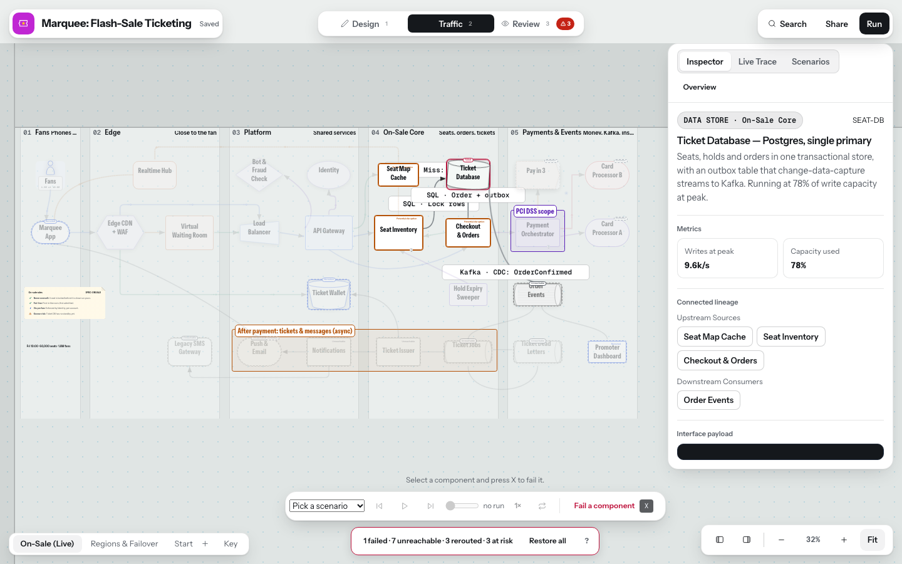
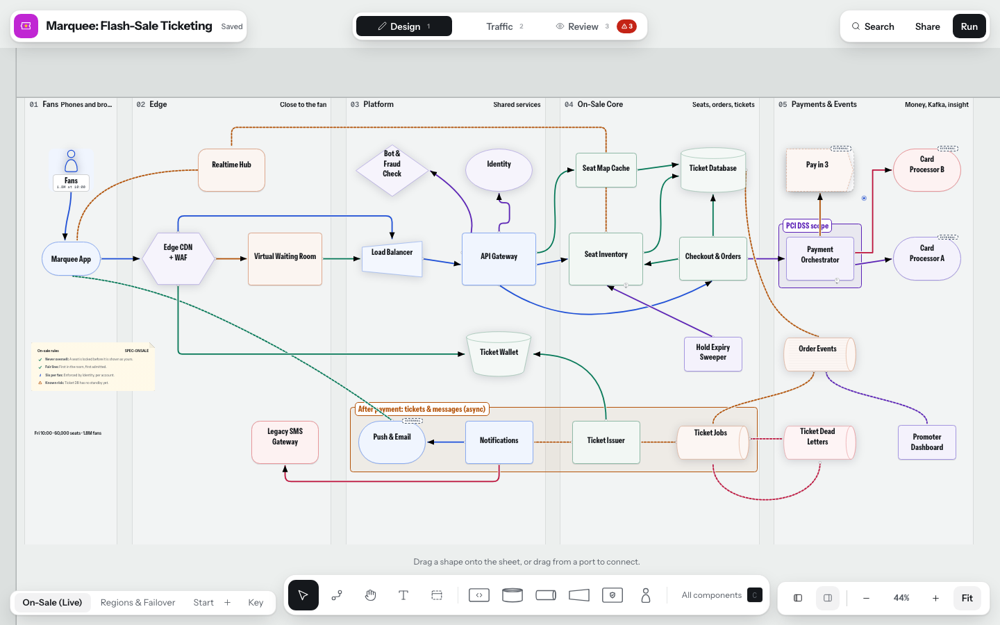
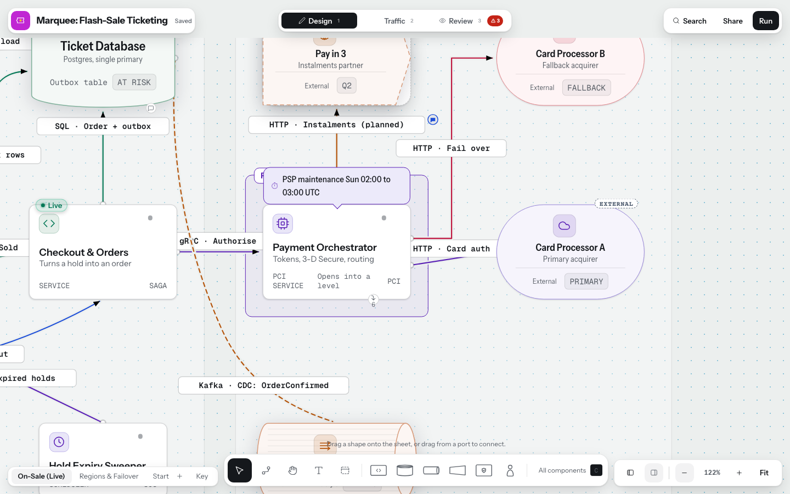
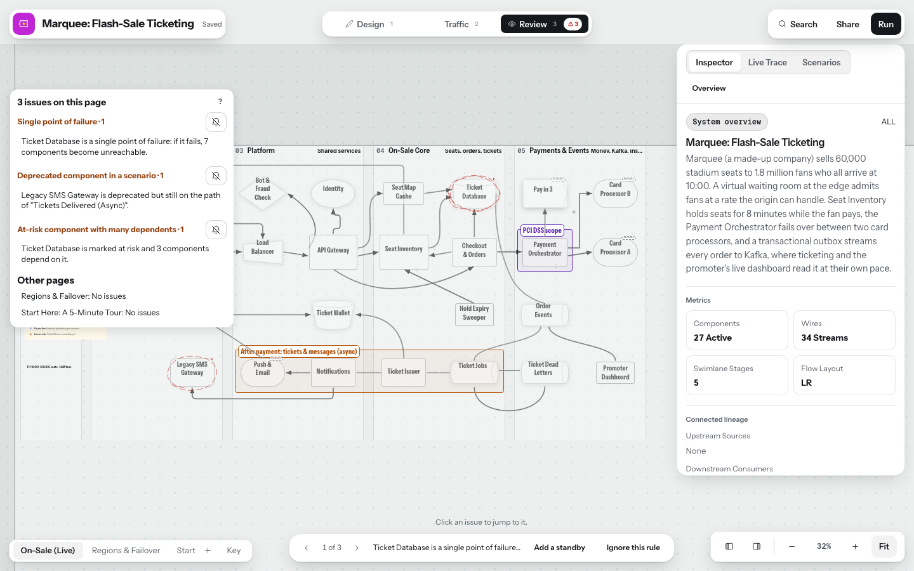
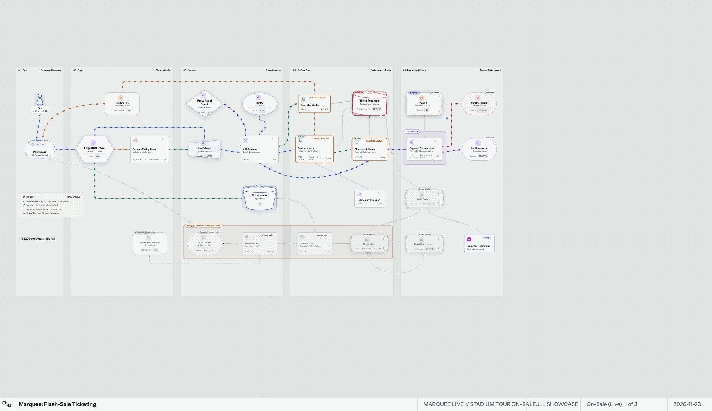
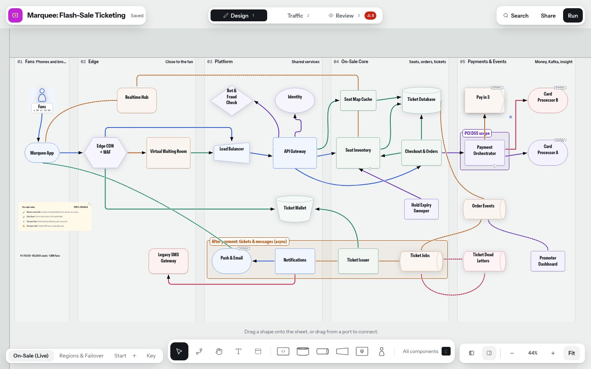

# ConduitCraft

**ConduitCraft** is an open-source architecture diagramming studio with animated traffic and scenarios. The idea is three steps: **draw it, run it, ship it.** Draw a system on a blank canvas, or import a Mermaid flowchart. Run it, by watching requests travel and failing a component to see what breaks. Ship it as a self-contained page, a picture or a GIF.



## Draw it, run it, ship it

### Draw it
The **Design** lens is a blank drafting canvas. Pick components from the tray, drag between ports to wire them, and group them in swimlanes and frames. Open a component to see the diagram one level deeper. Pin a **callout** to a component for what the diagram needs to say about it, such as a maintenance window or an access cut-off.





### Run it
The **Traffic** lens sends glowing beads down every wire and plays scenarios step by step. A wire's latency sets its pace, so fast and slow paths look clearly different. Select a component and press `X` to fail it: wires that can no longer carry traffic go grey and still, and the summary says how many components are unreachable, rerouted, delayed or slowed. The **Review** lens lists single points of failure, cycles, orphans and risky patterns, and each one jumps to its target. **Present** (`4`) shows the diagram on its own.



### Ship it
Export a self-contained interactive HTML page, SVG or PNG pictures, a looping GIF, or a Blueprint file that keeps the whole document. Exports keep the diagram style, the studio's fonts and the front-to-back order. Pictures carry a title block (title, tag, status, page and date) that the export dialog can turn off, and every SVG and HTML export carries a text description. **Share** copies a link that holds the whole diagram.

The GIF below was recorded with the studio's own GIF export, with Ticket Database failed.



## Highlights

- **Design lens: draw on a blank sheet**
  - 14 component stencils from the tray: **Actor**, **Core System**, **Service / API**, **Message Queue**, **Load Balancer**, **Cache**, **Rate Limiter**, **Scheduler**, **Stream / Log**, **Event Broker**, **Control Gate**, **Data Store**, **Object Storage** and **External Client**, plus swimlanes, frames, text and note cards. Any component can be marked as run by someone else.
  - **Callouts**: speech-bubble notes attached to one component (Info, Warning or Time), added from its right-click menu, the command palette or its Notes tab. A callout points at its component, moves, copies and deletes with it, and shows in PNG, GIF, canvas SVG and HTML exports.
  - Notes take a width (drag the right edge) and grow with their text; text labels take a width, a font size and a colour. Components, notes and text share one front-to-back order, so Bring to Front can put a note over a component.
  - Drag between ports to wire, or drag from a port into empty space and pick from a strip of likely kinds. Nine routing styles per wire (Smart, Straight, S-curve, Arc, Vertical Fan-out, Rounded Elbow, Sharp Step, Under U-Loop, Over U-Loop), draggable waypoints, and wires that keep clear of components and of each other's ports.
  - Several diagrams in one file as **pages**, **nested levels** you open with `Cmd/Ctrl+Enter`, and **frames** that own the components inside them.
  - The inspector is a floating properties card with Look, Behaviour and Notes. Find and replace, bulk edit, smart guides, auto-layout (including a layered ELK layout) and a live code pane (`Cmd/Ctrl+/`) that shows the Blueprint file beside the canvas.
  - A dragged component snaps to the centre of its swimlane. Zoomed out to Fit, names condense onto a few lines and wire labels appear on hover or selection, so a large diagram still reads.
  - Hide the left or right panel in any lens with `{` and `}`; the choice is remembered. Below 56 rem the inspector and tray become bottom sheets. Diagrams autosave to the browser, with a library on the Home screen, templates and snapshots.
  - Four diagram styles: Studio, Blueprint, Print and Sketch, in light (Vellum) and dark (Graphite).
- **Traffic lens: run it**
  - Beads flow down every animated wire, at a pace set by its latency (0.25x to 4x), and scenarios play as packets with a trace. Leaving Traffic stops the run and clears its highlights.
  - Fail a component (`X`) and the reachability model shows what is unreachable, rerouted, delayed or slowed. Queues buffer and drain, load balancers shift to a live target, caches report hits and misses, rate limiters reject with `429`, and schedulers start work on a timer.
- **Review lens: find the weak spots**
  - Single points of failure, cycles, orphans, queues without a dead-letter queue, caches with no store behind them, synchronous calls into external services, and more. Each finding is circled on the canvas and jumps to its target.
- **Import**
  - Mermaid flowcharts (open, drop or paste, with line-numbered diagnostics; subgraphs become swimlanes, levels or frames), draw.io, Excalidraw, Docker Compose, Kubernetes manifests, OpenAPI, AsyncAPI, and OpenTelemetry or Jaeger traces.
  - Mermaid is import only: saving a diagram opened from a `.mmd` file offers a Blueprint file instead. **Check for Drift** compares an imported diagram with a newer copy of its source file.
- **Export and share**
  - Blueprint file (`.blueprint.md`, YAML frontmatter plus a Mermaid block), Blueprint JSON, self-contained interactive HTML, SVG, PNG and a looping GIF, plus a share link that holds the whole diagram.
- **Command line and GitHub Action**
  - `pnpm conduitcraft render`, `check`, `diff` and `drift` work on Blueprint files, JSON and Mermaid with no browser. The [GitHub Action](./action.yml) checks and renders the diagrams in a repository and comments on pull requests with what changed.

## Documentation

The [release notes](./RELEASE_NOTES.md) list what changed in each version; the current one is 3.1.0.

The [guide](./docs/guide.md) is the Blueprint YAML schema, the wire routing modes, and the keyboard shortcuts.

The [showcase walkthrough](./docs/showcase.md) explains the example a new visitor sees first: a made-up flash-sale ticketing system that uses every feature, with scenarios to play, components to fail and the Review findings it keeps on purpose.



The [LLM rules](./docs/llm-rules.md) let any AI chat convert an architecture image, whiteboard photo, draw.io file or Mermaid diagram into a Blueprint file you can open and edit. Paste the rules and your diagram into the chat, save the reply as `name.blueprint.md`, and drop it on the canvas. **Copy LLM Rules** in the command palette copies them.

## Quick Start

Requires Node.js 22.6 or newer (the tests use Node's built-in TypeScript support) and [pnpm](https://pnpm.io). An `.nvmrc` is included, so `nvm use` picks the right version.

```bash
pnpm install
pnpm dev
```

Run the test suite and production build:

```bash
pnpm test
pnpm build
```

Use the command line tool on any diagram, for example:

```bash
pnpm conduitcraft check src/examples/flash-sale-ticketing.blueprint.json
```

To re-record the pictures above, run `pnpm build` and then `node tools/captureReadmeMedia.mjs`.

The browser tests (Playwright) build the app and drive it in Chromium. Install the browser once, then run them:

```bash
pnpm exec playwright install chromium
pnpm test:e2e
```

While you work, `pnpm test:e2e:quick` runs one core test per feature (the ones tagged `@quick`) in under a minute. Run the full suite before opening a pull request.

## License

Released under the [MIT License](./LICENSE).
