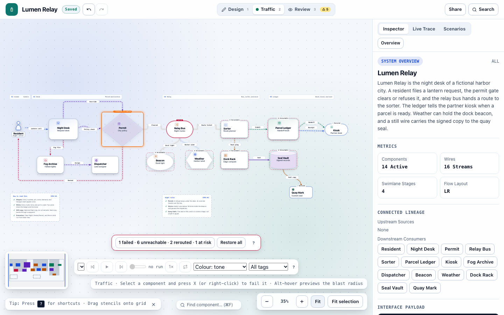
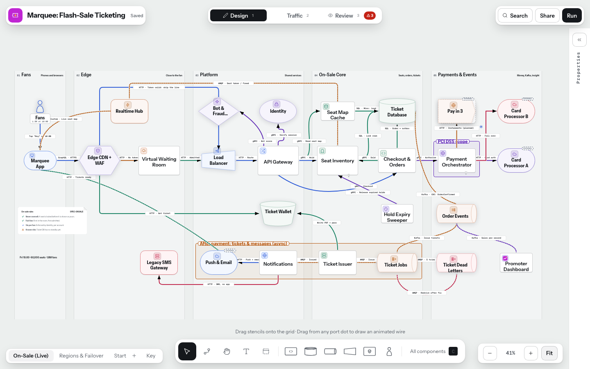
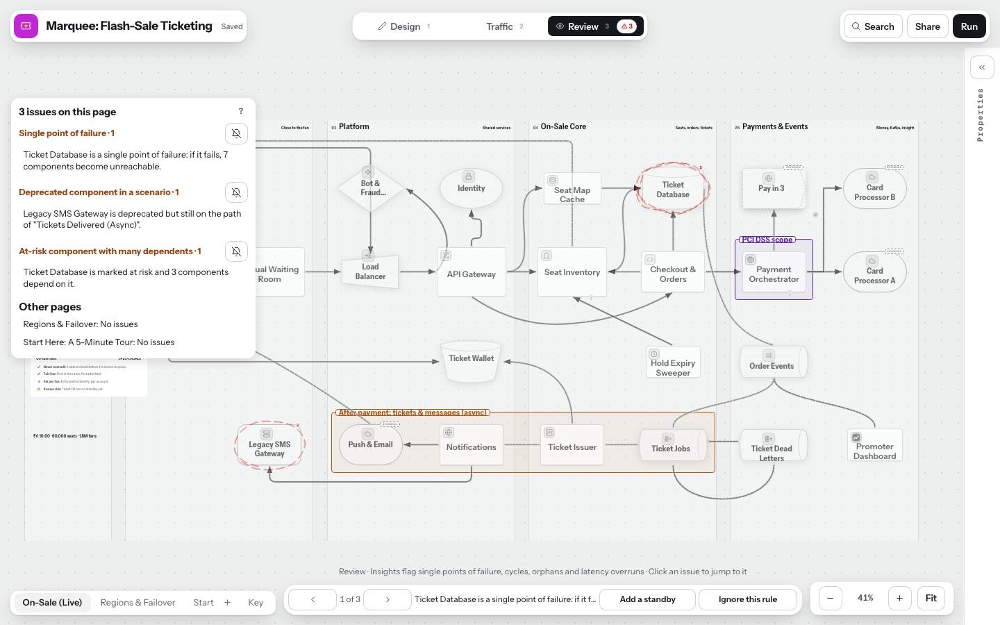
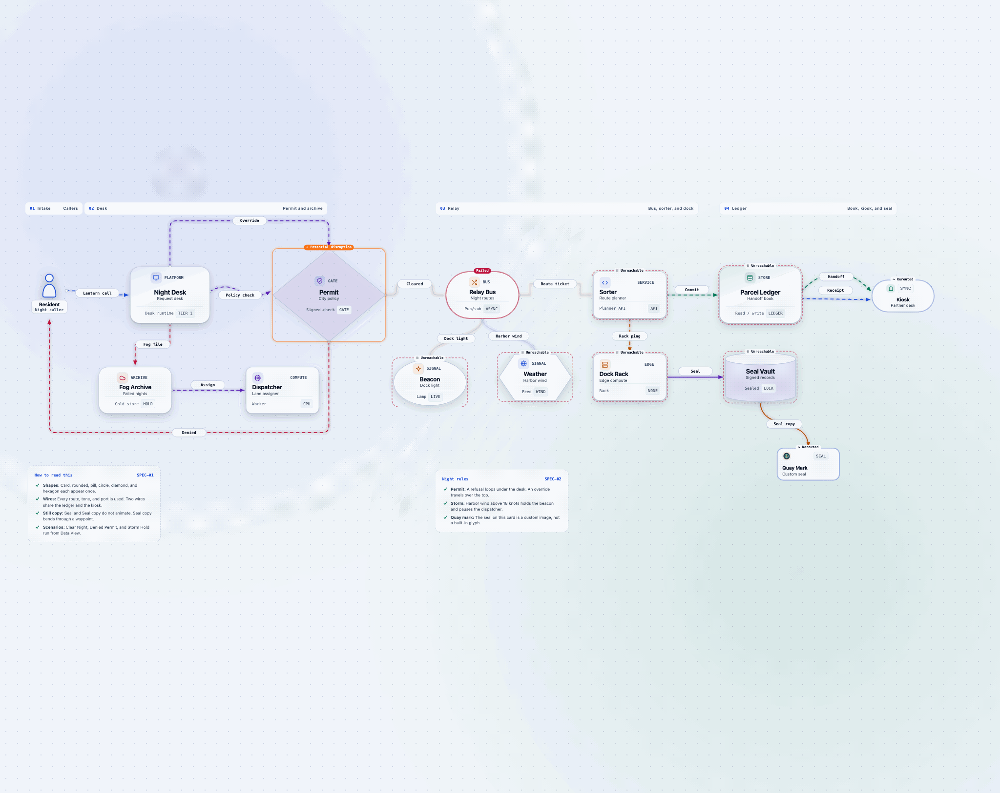
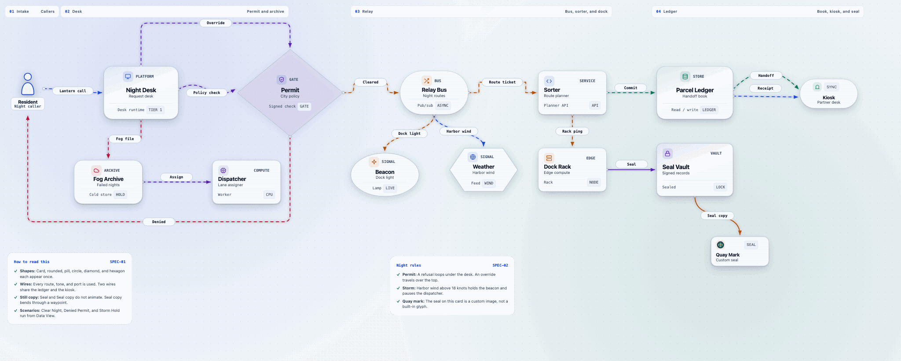
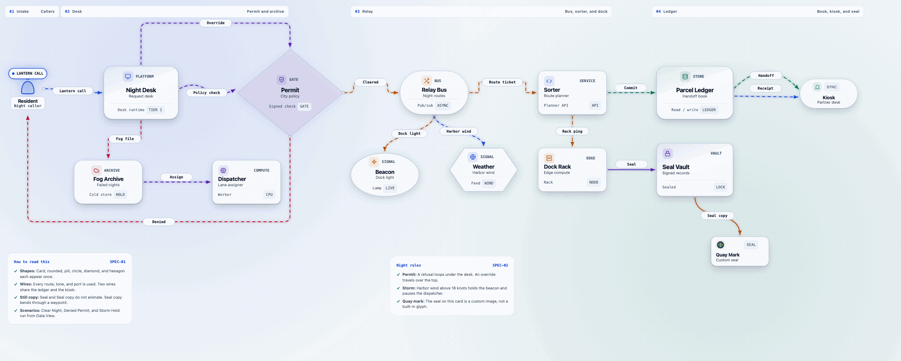
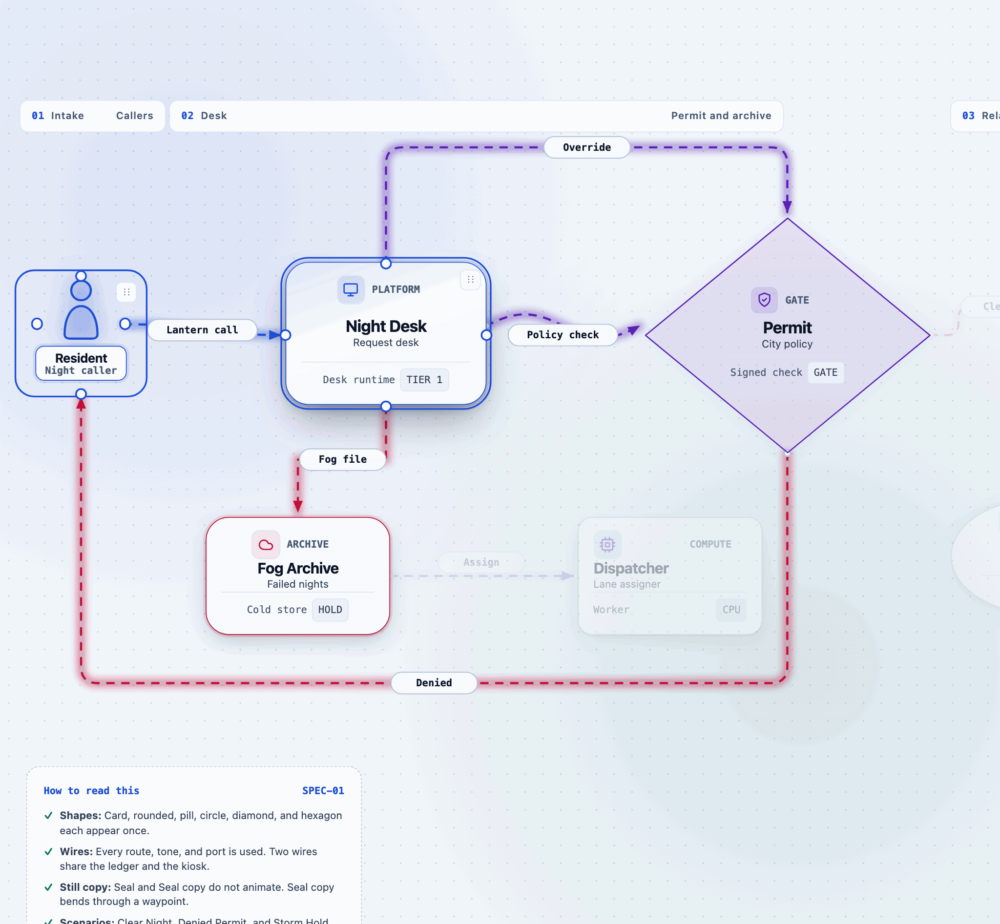
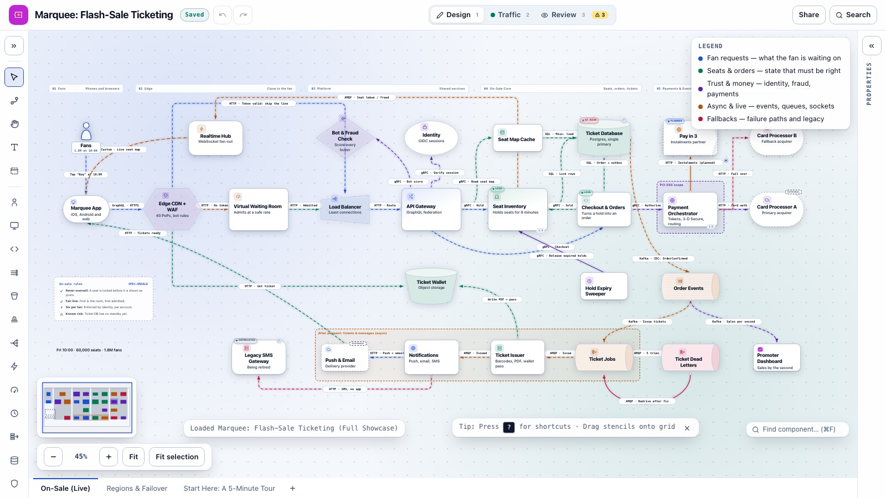

# ConduitCraft

**ConduitCraft** is an open-source architecture diagramming studio with animated traffic and scenarios. The idea is three steps: **draw it, run it, ship it.** Draw a system on a blank canvas, or import a Mermaid flowchart. Run it, by watching requests travel and failing a component to see what breaks. Ship it as a self-contained page, a picture or a GIF.



## Draw it, run it, ship it

### Draw it
The **Design** lens is a blank drafting canvas. Pick components from the palette, drag between ports to wire them, and group them in swimlanes. Open a component to see the diagram one level deeper.



### Run it
The **Traffic** lens plays scenarios as moving packets. Select a component and press `X` to fail it: the summary says how many components are unreachable or rerouted. The **Review** lens lists single points of failure, cycles and orphans, and each one jumps to its target.



### Ship it
Export a self-contained interactive HTML page, SVG or PNG pictures, a looping GIF, or a Blueprint file that keeps the whole document. Every SVG and HTML export carries a text description.

## Exported previews

The GIF below was recorded with the studio's own GIF export, with one component failed.



More exports of the Lumen Relay example:







## Highlights

- **Blank-canvas authoring (Design lens)**
  - Drag and drop 14 architectural stencils (**Human Actor**, **Core System**, **Service**, **Load Balancer**, **Cache**, **Rate Limiter**, **Scheduler**, **Message Queue**, **Stream / Log**, **Event Broker**, **Decision Gate**, **Data Store**, **Object Storage**, **Client Edge**) plus **Swimlane Stage** banners and **Notes / Spec** checklist cards.
  - Drag between directional ports (`top`, `right`, `bottom`, `left`) or use **Connect** mode to wire animated telemetry streams.
  - **9 Distinct Per-Wire Routing Styles** with a visual schematic picker: `Smart Auto`, `Direct Line`, `Smooth S-Curve`, `Curved Arc`, `Vertical Fan-out`, `Rounded Elbow`, `Sharp Step`, `Under U-Loop`, and `Over U-Loop`, plus draggable wire waypoints and automatic parallel-wire lane separation.
  - **Multi-Select & Alignment**: `Shift+click` or `Shift+drag` marquee box to select multiple components, move groups together, and align/distribute from the property inspector.
  - **Autosave & Session Recovery**: Debounced local storage autosave with 1-click session restore.
- **Animated traffic and scenarios (Traffic lens)**
  - Filter stream channels by tone (`Primary`, `Success`, `Exception`, `Control`).
  - Click any component to highlight upstream sources and downstream consumers while dimming unrelated paths, and inspect custom telemetry metrics and JSON contracts.
  - Trigger multi-step **Live Packet Simulations** with real-time execution traces.
- **Mermaid Import & Blueprint (`.md`) Files**
  - Open, drop or paste standard Mermaid flowcharts, with line-numbered validation diagnostics. Subgraphs import as swimlanes or as levels.
  - Mermaid is import only: ConduitCraft never writes a `.mmd` file, and saving a diagram opened from one offers a Blueprint file instead. The Blueprint file (YAML frontmatter plus a Mermaid block) is the text format it writes.
- **Zero-Dependency Exports**
  - Export a round-trippable **Blueprint JSON (`.blueprint.json`)** file that keeps the whole document, a short looping **GIF** of the telemetry animation, self-contained **Interactive Animated HTML (`.html`)** pages, or **SVG** and **PNG** pictures.

## Documentation

The [guide](./docs/guide.md) is the Blueprint YAML schema, the wire routing modes, and the keyboard shortcuts.

The [showcase walkthrough](./docs/showcase.md) explains the example a new visitor sees first: a made-up flash-sale ticketing system that uses every feature, with scenarios to play, components to fail and the Review findings it keeps on purpose.



## Quick Start

Requires Node.js 22.6 or newer (the tests use Node's built-in TypeScript support) and [pnpm](https://pnpm.io). An `.nvmrc` is included, so `nvm use` picks the right version.

```bash
pnpm install
pnpm dev
```

Run the test suite and production build:

```bash
pnpm test
pnpm build
```

To re-record the pictures above, run `pnpm build` and then `node tools/captureReadmeMedia.mjs`.

The browser tests (Playwright) build the app and drive it in Chromium. Install the browser once, then run them:

```bash
pnpm exec playwright install chromium
pnpm test:e2e
```

## License

Released under the [MIT License](./LICENSE).
