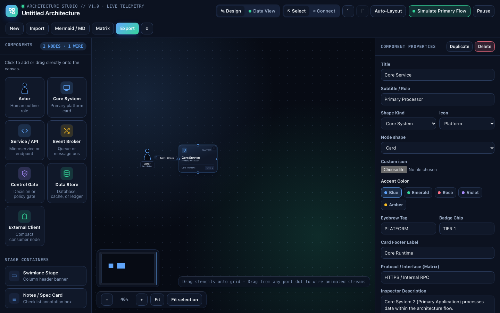
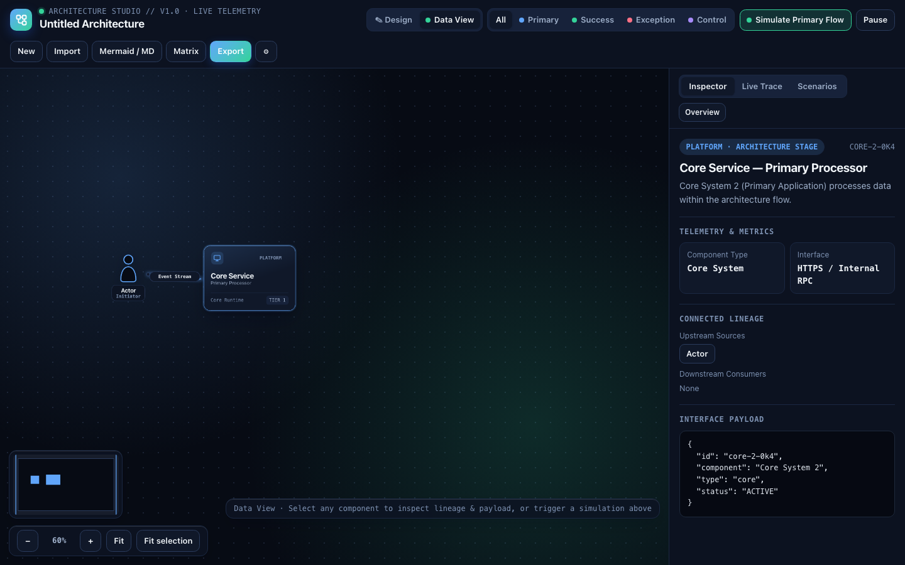

# ConduitCraft guide

This page is the schema and shortcut reference for Blueprint Studio. The [README](../README.md) covers install and the product overview.

## The canvas

Design mode is the drafting surface. The stencil palette sits on the left, the canvas in the middle, and the property inspector on the right. Data View hides the palette, filters wires by tone, and opens lineage, the live trace, and the scenario editor.





## Shortcuts

Undo and redo are ignored while an input, textarea, or select is focused. Copy, paste, duplicate, select-all, delete, and Escape apply in Design mode.

| Action | Shortcut |
| --- | --- |
| Undo | Cmd/Ctrl+Z |
| Redo | Cmd/Ctrl+Shift+Z, or Cmd/Ctrl+Y |
| Duplicate | Cmd/Ctrl+D |
| Copy | Cmd/Ctrl+C |
| Paste | Cmd/Ctrl+V |
| Select every node | Cmd/Ctrl+A |
| Delete the selection | Delete or Backspace |
| Clear Connect mode and the selection | Escape |
| Add or remove a node from the selection | Shift+click |
| Box-select | Shift+drag |
| Nudge the focused node | Arrow keys on its drag handle |
| Fine nudge | Shift+arrow (4px; a plain arrow moves 16px) |
| Drop a focused stencil | Enter or Space, at the center of the view |
| Activate a focused wire | Enter or Space |

A focused wire in Design mode selects that wire. The same keys in Data View select the wire’s target node. Delete or Backspace on a focused wire removes it in Design mode.

One undo step covers a whole drag, a text-edit gesture, or a burst of arrow nudges about 600ms apart. Adding, deleting, duplicating, pasting, and changing kind, icon, tone, route, or shape are each their own step.

The wheel zooms toward the pointer. The HUD also zooms, fits the diagram, and fits the selection. On a touch screen or with a pen, two fingers pan, and spreading them zooms. A click on the minimap recenters the view and leaves the zoom alone.

## Wire routing

Each wire has one routing mode. Blueprint Markdown accepts the aliases below. Blueprint JSON accepts only the canonical name. An unknown Markdown value becomes `auto`.

| Canonical | In the inspector | Also accepted in Markdown |
| --- | --- | --- |
| `auto` | Smart Auto (Context-Aware) | |
| `straight` | Direct Line | `direct`, `line` |
| `bezier` | Smooth S-Curve | `curve`, `scurve`, `s-curve` |
| `arc` | Curved Arc | `bow` |
| `fanout` | Vertical Fan-out | `fan-out`, `tree` |
| `orthogonal` | Rounded Elbow | `elbow`, `manhattan`, `rounded` |
| `step` | Sharp Step | `sharp`, `polyline`, `mitre` |
| `under` | Under U-Loop | `under-loop` |
| `over` | Over U-Loop | `over-loop` |

Ports are `auto`, `top`, `right`, `bottom`, or `left`. A waypoint is an optional `[x, y]` bend in canvas coordinates. Drag the handle on a wire to set it.

Tones are shared by nodes, wires, and simulation steps:

| Value | Label |
| --- | --- |
| `blue` | Primary |
| `emerald` | Success |
| `rose` | Exception |
| `violet` | Control |
| `amber` | Async |

In exported Mermaid, a Primary wire is `-->`, a Success wire is `==>`, and an Exception wire is `-.->`.

## Blueprint Markdown

A blueprint file is YAML front matter, then one fenced `mermaid` block. The editor writes both. On import, node positions, tones, routes, zones, notes, simulations, and brand come from the YAML. The Mermaid block supplies the graph the YAML does not already describe.

```yaml
---
title: Order Service
systemTag: CHECKOUT // V1
statusLabel: LIVE TELEMETRY
direction: LR
stageWidth: 1680
stageHeight: 920
overviewSummary: Actor calls the core, which writes the store.
brand:
  name: Northwind
  accent: "#0f766e"
nodes:
  actor:
    kind: actor
    accent: blue
    icon: actor
    title: Actor
    subtitle: Human Role
    eyebrow: ACTOR
    footerLeft: Interactive Session
    chip: ROLE
    zoneLabel: ""
    interfaceLabel: Web / SSO Session
    summary: ""
    position: [224, 304]
    metrics:
      - { label: Latency, value: "12 ms" }
    payload: {}
  core:
    kind: core
    accent: blue
    icon: monitor
    shape: rounded
    title: Core System
    subtitle: Primary Application
    eyebrow: PLATFORM
    footerLeft: Core Runtime
    chip: TIER 1
    zoneLabel: ""
    interfaceLabel: HTTPS / Internal RPC
    summary: ""
    position: [496, 288]
    metrics: []
    payload: {}
edges:
  - id: edge-1
    from: actor
    to: core
    sourcePort: right
    targetPort: left
    tone: blue
    route: orthogonal
    label: Place order
    animated: true
---
```

`direction` is `LR` or `TD`. Empty lists are omitted. A default brand (no name, accent, or logo) is omitted.

### Nodes

`nodes` is a map. The key is the id, sanitized to letters, digits, `_`, `.`, and `-`. `position` is `[x, y]`. Width and height come from the kind and are not stored.

| `kind` | Stencil | Mermaid shape the editor writes |
| --- | --- | --- |
| `actor` | Actor | `id(["Title"])` |
| `core` | Core System | `id[["Title"]]` |
| `service` | Service / API | `id["Title"]` |
| `bus` | Event Broker | `id("Title")` |
| `gate` | Control Gate | `id{{"Title"}}` |
| `store` | Data Store | `id[("Title")]` |
| `client` | External Client | `id[/"Title"/]` |

`shape` is the on-canvas outline: `card` (the default, omitted), `rounded`, `pill`, `circle`, `diamond`, or `hexagon`.

`icon` is one of `actor`, `monitor`, `bridge`, `shield`, `code`, `database`, `agency`, `server`, `lock`, `cloud`, `spark`, `cpu`, `globe`. `iconImage`, when present, is an image data URL (`png`, `jpeg`, `gif`, `webp`, or `svg+xml`, base64) and replaces that glyph. The studio rejects an upload larger than 280 KB.

`payload` is the contract. A JSON value is stored as structured YAML; anything that is not JSON stays a string. `metrics` is a list of `{ label, value }`. A map of label to value is also accepted on import.

### Edges, stages, notes, and scenarios

An edge needs `from` and `to` ids that exist in `nodes`. The editor writes `animated` as `true` or `false`. Leaving it out on import keeps the wire animated.

A swimlane stage is a `zones` entry: `id`, `number`, `title`, `subtitle`, `x`, and `width`. It has no vertical position. Nodes whose center falls inside that span are grouped under the stage when Mermaid is exported.

A notes card is `id`, `title`, `code`, `position: [x, y]`, and `items` of `{ title, text }`.

`simulations` is the authored scenario list. Each scenario has `id`, `name`, `tone`, and `steps`. A step has `id`, `nodes` (ids, in visit order), `tone`, `label`, and `trace`. When the list is absent, Data View synthesizes a primary flow from the wires, and an exception flow when a rose or under-loop wire exists. The first edit in the Scenarios tab saves that generated list onto the blueprint. Removing every authored scenario brings the generated flows back.

### Brand

`brand` is optional:

| Field | Meaning |
| --- | --- |
| `name` | Header label, at most 80 characters. |
| `accent` | `#rgb` or `#rrggbb`. Three-digit form expands to six. Anything else is dropped. |
| `logo` | Image data URL, same rule as `iconImage`. A remote URL is dropped and reported as `brand-logo`. |

The name, accent, and logo appear on the studio header and on the exported HTML page. Empty fields keep the built-in mark.

## Blueprint JSON

Blueprint JSON is the file that keeps the whole studio document. The export dialog highlights this file. A GIF is a short loop of the moving wires, not a document. Markdown stays in the code editor.

Export writes one file:

```json
{
  "kind": "conduitcraft.blueprint",
  "version": 1,
  "document": {}
}
```

`document.nodes` is an array. Each node has `id`, `x`, `y`, `width`, and `height` rather than a `position` pair. Edges, zones, notes, simulations, and `brand` use the same field names as the YAML. A file that is only the document object is accepted when it has a `nodes` array. Routing values must be the canonical names from the table above.

## Mermaid

A `.mmd` file is a flowchart. The editor writes `flowchart LR` or `flowchart TD`. On import, `RL` is treated as left-to-right and `TB` or `BT` as top-to-bottom. Subgraphs become swimlane stages. Node shape brackets pick the kind, using the same brackets listed in the node table. A subtitle is a second line inside the label, separated by `<br/>`.
