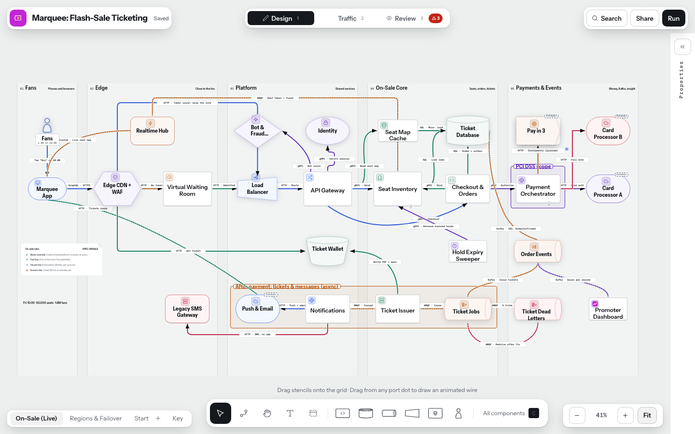
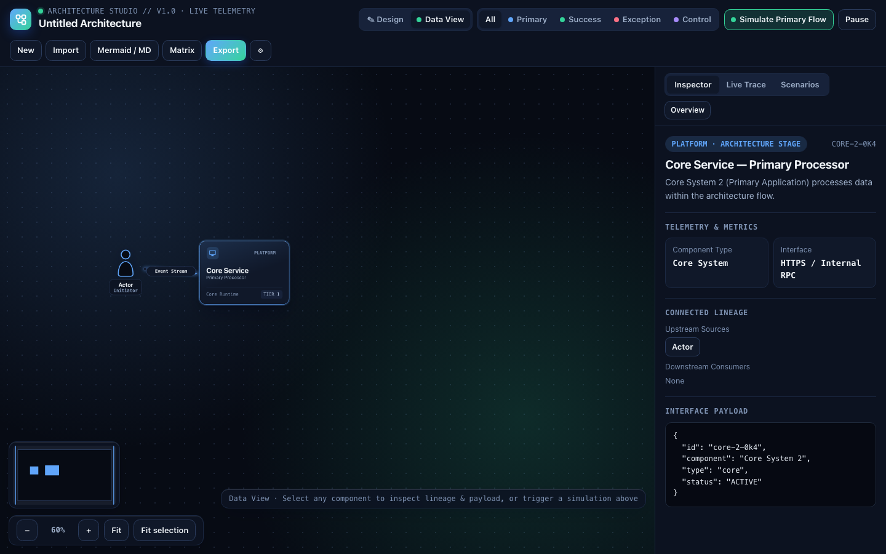

# ConduitCraft guide

This page is the guide and schema reference for ConduitCraft. The [README](../README.md) covers install and the product overview.

## The canvas

Design mode is the drafting surface. The stencil palette sits on the left, the canvas in the middle, and the property inspector on the right. Data View hides the palette, filters wires by tone, and opens lineage, the live trace, and the scenario editor.





## Lenses

A lens changes what the canvas emphasises, not what you can do. Press `1` to `4` to switch, or use the lens buttons in the top bar.

| Key | Lens | What it is for |
| --- | --- | --- |
| `1` | Design | Build the diagram. Components, wires and swimlanes edit freely. |
| `2` | Traffic | Run scenarios and watch packets travel. You can also fail components here. |
| `3` | Review | See the insights the rules found, as badges on the canvas and a list beside it. |
| `4` | Present | A clean view for showing the diagram to others. |

## Shortcuts

Undo and redo are ignored while an input, textarea, or select is focused. Copy, paste, duplicate, select-all, delete, and Escape apply in Design mode.

| Action | Shortcut |
| --- | --- |
| Undo | Cmd/Ctrl+Z |
| Redo | Cmd/Ctrl+Shift+Z, or Cmd/Ctrl+Y |
| Duplicate | Cmd/Ctrl+D |
| Copy | Cmd/Ctrl+C |
| Paste | Cmd/Ctrl+V |
| Select every node | Cmd/Ctrl+A |
| Delete the selection | Delete or Backspace |
| Clear Connect mode and the selection | Escape |
| Add or remove a node from the selection | Shift+click |
| Box-select | Shift+drag |
| Nudge the focused node | Arrow keys on its drag handle |
| Fine nudge | Shift+arrow (4px; a plain arrow moves 16px) |
| Drop a focused stencil | Enter or Space, at the center of the view |
| Activate a focused wire | Enter or Space |

A focused wire in Design mode selects that wire. The same keys in Data View select the wire’s target node. Delete or Backspace on a focused wire removes it in Design mode.

One undo step covers a whole drag, a text-edit gesture, or a burst of arrow nudges about 600ms apart. Adding, deleting, duplicating, pasting, and changing kind, icon, tone, route, or shape are each their own step.

The wheel zooms toward the pointer. The HUD also zooms, fits the diagram, and fits the selection. On a touch screen or with a pen, two fingers pan, and spreading them zooms. A click on the minimap recenters the view and leaves the zoom alone.

## Wire routing

Each wire has one routing mode. A Blueprint file accepts the aliases below. Blueprint JSON accepts only the canonical name. An unknown value in a Blueprint file becomes `auto`.

| Canonical | In the inspector | Also accepted in a Blueprint file |
| --- | --- | --- |
| `auto` | Smart Auto (Context-Aware) | |
| `straight` | Direct Line | `direct`, `line` |
| `bezier` | Smooth S-Curve | `curve`, `scurve`, `s-curve` |
| `arc` | Curved Arc | `bow` |
| `fanout` | Vertical Fan-out | `fan-out`, `tree` |
| `orthogonal` | Rounded Elbow | `elbow`, `manhattan`, `rounded` |
| `step` | Sharp Step | `sharp`, `polyline`, `mitre` |
| `under` | Under U-Loop | `under-loop` |
| `over` | Over U-Loop | `over-loop` |

Ports are `auto`, `top`, `right`, `bottom`, or `left`. A waypoint is an optional `[x, y]` bend in canvas coordinates. Drag the handle on a wire to set it.

Tones are shared by nodes, wires, and simulation steps:

| Value | Label |
| --- | --- |
| `blue` | Primary |
| `emerald` | Success |
| `rose` | Exception |
| `violet` | Control |
| `amber` | Async |

In the Blueprint file's Mermaid block, a Primary wire is `-->`, a Success wire is `==>`, and an Exception wire is `-.->`.

## Component fields

Select a component to edit it in the inspector. **Basics** holds the title, kind, subtitle and the text on the card. **Appearance** holds the icon, colour and shape. **Review & Status** holds status, tags, links, owner and how the component copes with failing. **More details** and **Metrics & Contract** hold the remaining text fields, the metrics and the payload.

Only the title is needed. The label above the title, the badge, the footer and the interface line add text to the card, so leave them empty when they say nothing useful.

## Traffic and scenarios

A scenario is an ordered list of steps. Each step sends a packet along one wire. Open the Traffic lens, pick a scenario in the run bar and press Play. The scrubber moves through the steps, the speed button changes the pace, and Loop repeats the run.

Give a scenario a **latency budget** in milliseconds. Each wire has a typical latency, and the Review lens flags a scenario whose path adds up to more than its budget.

**Colour components by** in the run bar paints components by tone, status or tag. **Show only components with tag** hides everything else.

## Failing components

In the Traffic or Review lens, select a component and press `X` (or choose **Fail this component**) to see what stops working. Everything that can no longer be reached from an entry point fades out, and a failure summary counts what was lost. Press `X` again, or **Restore all**, to bring things back.

How a component copes is set under **Review & Status**:

- **Replicas.** More than one running copy means a failure degrades the component instead of taking it down.
- **Fallback.** Another component takes over the incoming traffic while this one is down.
- **Circuit breaker.** Recorded for the reader. It does not change what is reachable.

Failing a component also fails everything inside its level. Failing a component inside a level leaves the parent alone.

## Review and insights

The Review lens runs a set of rules over every level of the diagram. The list groups issues by rule, and a click selects the component or wire the issue is about. **Mute** hides a rule for this diagram, and the choice is saved with it.

| Rule | Level | What it means |
| --- | --- | --- |
| Latency budget exceeded | Error | A scenario's wires add up to more than its latency budget. Shorten the path or raise the budget. |
| Single point of failure | Warning | If this component fails, at least one end point can no longer be reached. Add replicas or a fallback. |
| Synchronous cycle | Warning | Components call each other synchronously in a loop. Mark one wire async to break it. |
| Deprecated component in a scenario | Warning | A component with the deprecated status is still on a scenario's path. |
| At-risk component with many dependents | Warning | A component with the at-risk status has three or more components calling it. |
| Component with no wires | Info | Nothing connects to this component. |
| Data store nothing reads from | Info | Every wire into this data store only writes to it. |
| Wire between services without a label | Info | A wire between two services has no label, so a reader cannot tell what it carries. |

## Levels

A component can open into a diagram of its own, called a level. Use the level badge on a component to go in, and the breadcrumb above the canvas, or `Cmd/Ctrl+Up`, to come back out. A level can hold its own swimlanes, components and wires, and can contain further levels.

Insights run on every level. The text outline lists a component's level under it as a row, and Enter on that row opens it.

## Legend and tags

The **colour legend** is in the inspector when nothing is selected. Give each wire colour a meaning your team uses, such as "Payments" for Control. The names replace the defaults in the pickers, the filter and the exported page.

**Tags** are free labels on a component or a wire. Filter the canvas by one tag, or colour components by tag, from the run bar.

## Links and owner

Under **Review & Status**, **Owner** names the team or person responsible for a component. **Links** point to where to read more: a repository, runbook, dashboard, docs page or on-call rota. Only `http`, `https` and `mailto` links are kept, and they open in a new tab.

## Wire fields

Select a wire to edit it. A wire has a **label**, a **protocol**, a **call style** (synchronous or async), a typical **latency** in milliseconds, its **source** and **target** components, the **ports** it leaves and enters by, and its **routing** (see [Wire routing](#wire-routing)). Latency adds up along a scenario for the budget check, and a loop of synchronous wires is reported by Review.

## Text outline

The outline is a list of the diagram that you can read with a screen reader and walk with the keyboard. Open it from the command palette (**Toggle Text Outline**) or the More actions menu.

| Key | Action |
| --- | --- |
| `Up` / `Down` | Move between rows |
| `Home` / `End` | First or last row |
| `Right` | Open the row, or step into it |
| `Left` | Close the row, or step out to its parent |
| `Enter` / `Space` | Select the component or wire and pan to it. On a level row, open that level. On a swimlane, open or close it. |
| `Esc` | Close the outline |

The rows are swimlane, then component, then the component's outgoing wires. A component that opens into a level has one more row, "Opens into N components", which holds the level's own rows.

## Share and export

**Share** copies a link that holds the whole diagram, so anyone with it can open your work without an account. A logo or custom icon you embedded is left out of the link to keep it short. A very long link shows a warning first.

**Export** offers a Blueprint file (the full document), an animation (`.gif`), a single-page interactive HTML file, an SVG and a PNG. Each image and page carries a text description of the diagram: the SVG has a title and description, the HTML page has a hidden description, and the PNG dialog has an **Alt text** box with a Copy button. The palette command **Copy as text** copies the same description.

## Blueprint file

A blueprint file is YAML front matter, then one fenced `mermaid` block. The editor writes both. On import, node positions, tones, routes, zones, notes, simulations, and brand come from the YAML. The Mermaid block supplies the graph the YAML does not already describe.

```yaml
---
title: Order Service
systemTag: CHECKOUT // V1
statusLabel: LIVE TELEMETRY
direction: LR
stageWidth: 1680
stageHeight: 920
overviewSummary: Actor calls the core, which writes the store.
brand:
  name: Northwind
  accent: "#0f766e"
nodes:
  actor:
    kind: actor
    accent: blue
    icon: actor
    title: Actor
    subtitle: Human Role
    eyebrow: ACTOR
    footerLeft: Interactive Session
    chip: ROLE
    zoneLabel: ""
    interfaceLabel: Web / SSO Session
    summary: ""
    position: [224, 304]
    metrics:
      - { label: Latency, value: "12 ms" }
    payload: {}
  core:
    kind: core
    accent: blue
    icon: monitor
    shape: rounded
    title: Core System
    subtitle: Primary Application
    eyebrow: PLATFORM
    footerLeft: Core Runtime
    chip: TIER 1
    zoneLabel: ""
    interfaceLabel: HTTPS / Internal RPC
    summary: ""
    position: [496, 288]
    metrics: []
    payload: {}
edges:
  - id: edge-1
    from: actor
    to: core
    sourcePort: right
    targetPort: left
    tone: blue
    route: orthogonal
    label: Place order
    animated: true
---
```

`direction` is `LR` or `TD`. Empty lists are omitted. A default brand (no name, accent, or logo) is omitted.

### Nodes

`nodes` is a map. The key is the id, sanitized to letters, digits, `_`, `.`, and `-`. `position` is `[x, y]`. Width and height come from the kind and are not stored.

| `kind` | Stencil | Mermaid shape the editor writes |
| --- | --- | --- |
| `actor` | Actor | `id(["Title"])` |
| `core` | Core System | `id[["Title"]]` |
| `service` | Service / API | `id["Title"]` |
| `bus` | Event Broker | `id("Title")` |
| `gate` | Control Gate | `id{{"Title"}}` |
| `store` | Data Store | `id[("Title")]` |
| `client` | External Client | `id[/"Title"/]` |

`shape` is the on-canvas outline: `card` (the default, omitted), `rounded`, `pill`, `circle`, `diamond`, or `hexagon`.

`icon` is one of `actor`, `monitor`, `bridge`, `shield`, `code`, `database`, `agency`, `server`, `lock`, `cloud`, `spark`, `cpu`, `globe`. `iconImage`, when present, is an image data URL (`png`, `jpeg`, `gif`, `webp`, or `svg+xml`, base64) and replaces that glyph. The studio rejects an upload larger than 280 KB.

`payload` is the contract. A JSON value is stored as structured YAML; anything that is not JSON stays a string. `metrics` is a list of `{ label, value }`. A map of label to value is also accepted on import.

### Edges, stages, notes, and scenarios

An edge needs `from` and `to` ids that exist in `nodes`. The editor writes `animated` as `true` or `false`. Leaving it out on import keeps the wire animated.

A swimlane stage is a `zones` entry: `id`, `number`, `title`, `subtitle`, `x`, and `width`. It has no vertical position. Nodes whose center falls inside that span are grouped under the stage in the Blueprint file's Mermaid block.

A notes card is `id`, `title`, `code`, `position: [x, y]`, and `items` of `{ title, text }`.

`simulations` is the authored scenario list. Each scenario has `id`, `name`, `tone`, and `steps`. A step has `id`, `nodes` (ids, in visit order), `tone`, `label`, and `trace`. When the list is absent, Data View synthesizes a primary flow from the wires, and an exception flow when a rose or under-loop wire exists. The first edit in the Scenarios tab saves that generated list onto the blueprint. Removing every authored scenario brings the generated flows back.

### Brand

`brand` is optional:

| Field | Meaning |
| --- | --- |
| `name` | Header label, at most 80 characters. |
| `accent` | `#rgb` or `#rrggbb`. Three-digit form expands to six. Anything else is dropped. |
| `logo` | Image data URL, same rule as `iconImage`. A remote URL is dropped and reported as `brand-logo`. |

The name, accent, and logo appear on the studio header and on the exported HTML page. Empty fields keep the built-in mark.

## Blueprint JSON

Blueprint JSON is the file that keeps the whole studio document. The export dialog highlights this file. A GIF is a short loop of the moving wires, not a document. The Blueprint file text stays in the code editor.

Export writes one file:

```json
{
  "kind": "conduitcraft.blueprint",
  "version": 1,
  "document": {}
}
```

`document.nodes` is an array. Each node has `id`, `x`, `y`, `width`, and `height` rather than a `position` pair. Edges, zones, notes, simulations, and `brand` use the same field names as the YAML. A file that is only the document object is accepted when it has a `nodes` array. Routing values must be the canonical names from the table above.

## Importing Mermaid

ConduitCraft reads Mermaid but never writes it. Open, drop or paste a `.mmd` flowchart to import it. Saving a diagram opened from a `.mmd` file never changes that file: it opens Save As with a Blueprint file name (`name.md`). The only Mermaid the editor writes is the block inside a Blueprint file, which uses `flowchart LR` or `flowchart TD`.

On import, `RL` is treated as left-to-right and `TB` or `BT` as top-to-bottom. Subgraphs become swimlane stages, or, with **Subgraphs as: Levels** in the Blueprint file dialog, components whose levels hold the subgraph's nodes. Node shape brackets pick the kind, using the same brackets listed in the node table. A subtitle is a second line inside the label, separated by `<br/>`.
