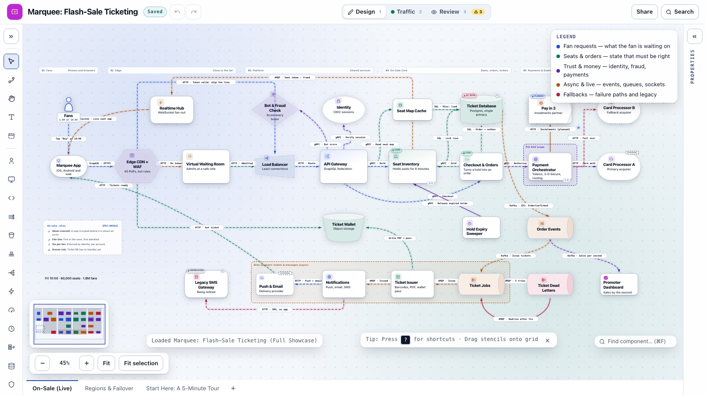
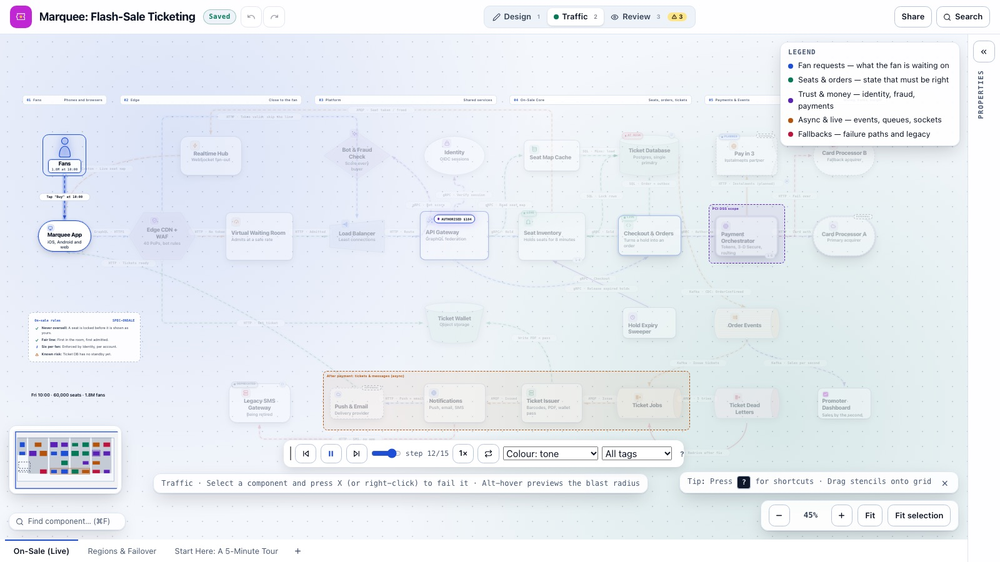
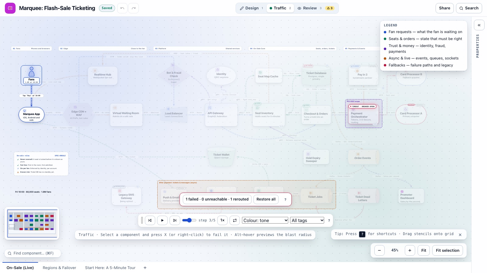
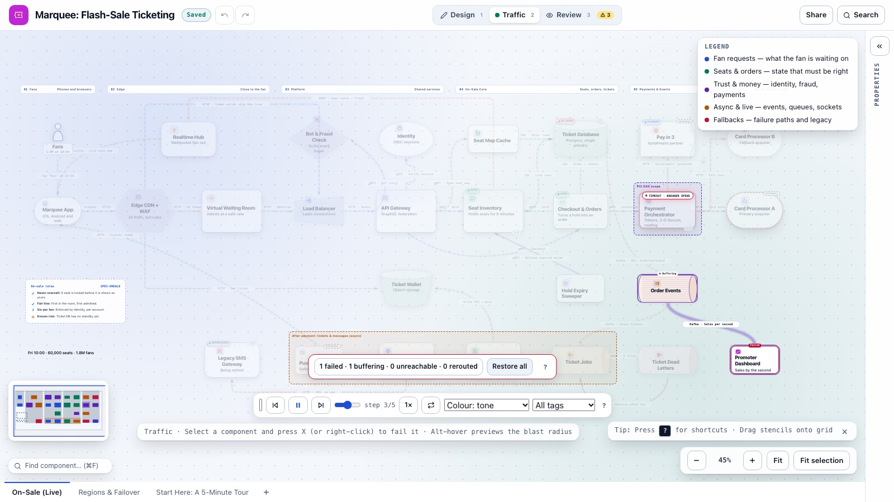
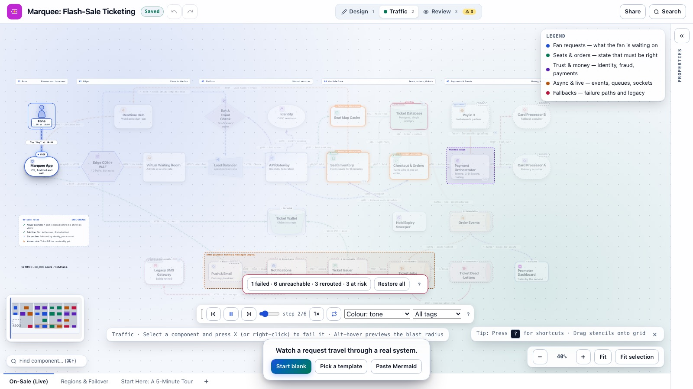
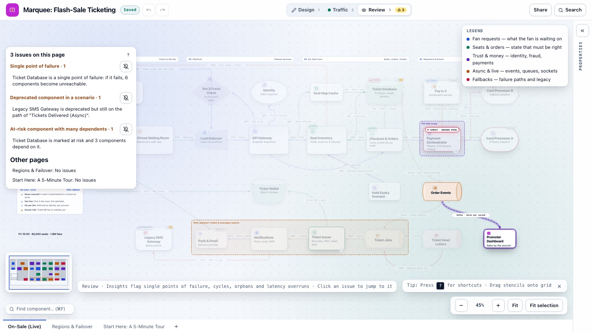
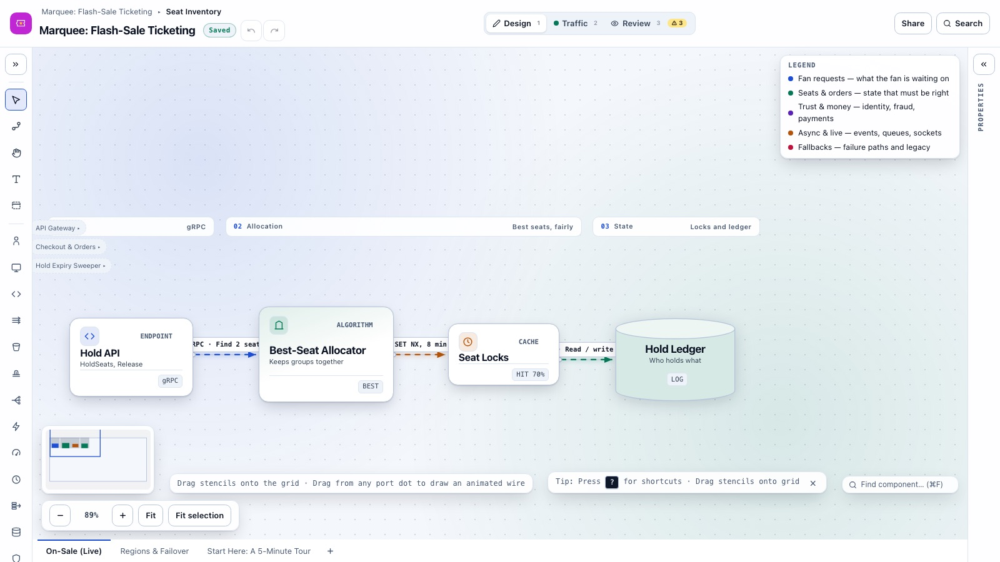
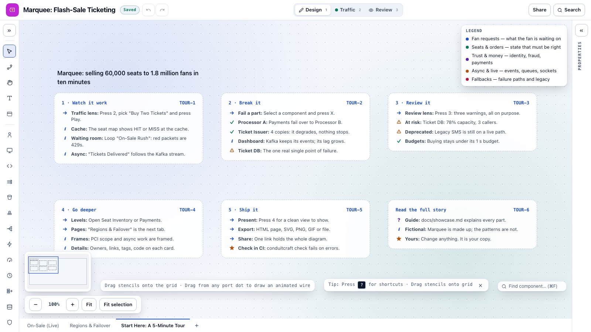

# The showcase: Marquee flash-sale ticketing

The showcase is the example ConduitCraft opens for a brand-new visitor, and the first card in the template gallery. It is one realistic system drawn with every feature the app has, so you can see what each feature is for instead of reading about it. This page walks through the example and points out what to try at each stop.

Marquee is a made-up company. The patterns it uses (waiting rooms, seat holds, transactional outboxes, circuit breakers, dead-letter queues) are real and common in ticketing, retail drops and anything else that sells a fixed stock to a crowd at one moment.

**Open it:** it plays on its own the first time you open ConduitCraft. After that, press `Cmd/Ctrl+K` and run **Load Showcase**, or pick **Marquee: Flash-Sale Ticketing** in the template gallery. It opens as a new diagram, so you can change anything.

The source file is [`src/examples/flash-sale-ticketing.blueprint.json`](../src/examples/flash-sale-ticketing.blueprint.json). A full-size picture of each page, exported by the app, is linked under [Pages](#pages).

## The story

On Friday at 10:00 a stadium tour goes on sale: 60,000 seats, and 1.8 million fans who all press Buy in the same minute. The system has to:

1. **Survive the stampede.** Most of those requests must never reach the servers that sell seats.
2. **Never sell a seat twice.** A seat is locked before a fan is told it is theirs.
3. **Take the money reliably,** even when a card processor has a bad day.
4. **Deliver every ticket,** even if part of the ticket pipeline is down for a while.
5. **Show everyone the truth live.** The seat map greys out seats as they sell, and the promoter watches sales by the second.

Each of these goals has its own part of the diagram, and a scenario you can play.

## Reading the diagram

The page is split into five **swimlanes**, left to right, following a request from the fan's phone to the money:

| Swimlane | What lives there |
| --- | --- |
| 01 Fans | The fans and the Marquee app. |
| 02 Edge | Everything close to the fan: the CDN and firewall, the virtual waiting room, the realtime hub that keeps seat maps live, and the old SMS gateway. |
| 03 Platform | Shared services: load balancer, API gateway, identity, bot and fraud checks, ticket storage, notifications. |
| 04 On-Sale Core | Seats, orders and tickets: the seat map cache, Seat Inventory, Checkout & Orders, the ticket database, the hold sweeper and the ticket queue. |
| 05 Payments & Events | The Payment Orchestrator and the card processors, the Kafka order stream, dead letters and the promoter's dashboard. |

The top two rows are the **synchronous** path: the fan is waiting for an answer. The bottom row, inside the amber frame **"After payment: tickets & messages (async)"**, is work that happens after the fan has been told "You're going!".

**Colours** carry meaning, and the legend on the canvas names them for this diagram:

| Colour | Means here |
| --- | --- |
| Blue | Fan requests: what the fan is waiting on. |
| Green | Seats and orders: state that must be right. |
| Violet | Trust and money: identity, fraud, payments. |
| Amber | Async and live: events, queues, sockets. |
| Rose | Fallbacks: failure paths and legacy. |

**Dashed wires** are asynchronous; solid ones are calls someone waits on. Each wire label starts with its protocol (`HTTP`, `gRPC`, `GraphQL`, `SQL`, `Kafka`, `AMQP`, and `Custom` for the WebSocket), and most carry a typical latency that the latency budget adds up.

**Dashed outlines with an `EXTERNAL` tag** are run by someone else: the two card processors, the push and email provider, and the planned "Pay in 3" partner.

**Badges** on the cards show status: Seat Inventory and Checkout are `LIVE`, the Ticket Database is `AT RISK`, the SMS gateway is `DEPRECATED`, and "Pay in 3" is `PLANNED`.

## The components

Select any component and the inspector shows its summary, metrics, owner, links, tags and, for the main services, a sample request and response under **Metrics & Contract**.

| Component | Kind | Why it is there |
| --- | --- | --- |
| Fans | Human actor | Where most scenarios start. |
| Marquee App | Client | Holds the fan's queue token, shows the live seat map, receives the tickets. |
| Edge CDN + WAF | Gate (hexagon) | Stops bots at the edge and checks the queue token. Fans with a valid token skip the waiting room (the wire that loops over the top). |
| Virtual Waiting Room | Rate limiter | Admits 2 of every 5 requests, so the origin is never asked to sell faster than it can. It fails closed. |
| Realtime Hub | Event broker | Pushes "seat taken" and "seat freed" to 1.2 million open seat maps. Its wire to the app flows both ways. |
| Load Balancer | Load balancer | Spreads admitted traffic over the gateway's pods by least connections. |
| API Gateway | Gate | One GraphQL endpoint for the app; calls the services over gRPC. |
| Identity | Service (circle) | Verifies the session and enforces six tickets per fan. |
| Bot & Fraud Check | Gate (diamond) | Scores every buyer; above 0.8 the request is refused. |
| Seat Map Cache | Cache | Answers 92% of seat-map reads; misses load from the database. |
| Seat Inventory | Core system | Holds seats for 8 minutes while the fan pays. **Opens into a level.** |
| Checkout & Orders | Service | Turns a hold into an order, writing the order and its outbox event in one transaction. |
| Ticket Database | Data store | Seats, holds, orders and the outbox. The one known single point of failure. |
| Hold Expiry Sweeper | Scheduler | Every 30 seconds, releases unpaid holds so the seats go back on sale. |
| Payment Orchestrator | Service, in the **PCI DSS scope** frame | The only service that touches card data. **Opens into a level.** |
| Card Processor A and B | External | A takes 90% of charges; B is the fallback, kept warm with the other 10%. |
| Pay in 3 | External, planned (asymmetric outline) | An instalments partner planned for next tour. Its wire does not animate because it does not exist yet. |
| Order Events | Stream (Kafka) | Every confirmed order as an event, kept 7 days in 12 partitions. Ticketing and the dashboard each read at their own pace. |
| Ticket Jobs | Queue (FIFO) | One job per order, handed to exactly one issuer. After 5 failed tries a job goes to the dead letters. |
| Ticket Dead Letters | Queue | Jobs that kept failing, for a person to look at. A dashed rose wire redrives them once the cause is fixed. |
| Ticket Issuer | Service | Issues rotating barcodes and renders the PDF and wallet pass. |
| Ticket Wallet | Object storage | Where tickets live. Fans download them through the CDN with a signed link. |
| Notifications | Service | Push and email first, SMS only for fans without the app. |
| Push & Email | External | The delivery provider. If it is down, notifications fall back to SMS. |
| Legacy SMS Gateway | Service, deprecated | The old box from the previous platform, due to be replaced. |
| Promoter Dashboard | Client with a custom icon | Sales per second, read straight from the stream. |

## Scenarios to play

Press `2` for the **Traffic** lens, pick a scenario in the run bar and press Play. Each step sends a packet along a real wire, and the trace beside the canvas says what is happening and why.

| Scenario | What to watch |
| --- | --- |
| **On-Sale Rush (Waiting Room)** | The stampede. Turn on Loop: the waiting room lets 2 of every 5 through, and the rest turn red with a `429`, which here means "keep waiting". Admitted fans read the seat map from the cache, and on a miss the packet shows `MISS` and carries on to the database. This is the scenario first run plays. |
| **Buy Two Tickets (Hold → Pay → Confirm)** | The whole purchase in 16 steps: token check, sign-in and bot score, seat map, a hold on two seats, every open map updating, checkout, payment, sold, and the order and outbox written together. It has a **latency budget** of 600 ms; its wires add up to 449 ms, most of it the 350 ms card processor. |
| **Tickets Delivered (Async)** | What happens after "You're going!": change-data capture reads the outbox into Kafka, the dashboard and ticketing both read the event, one issuer takes the job, the tickets are stored, and the fan gets a push. One step goes through the legacy SMS gateway; that is why Review warns about it. |
| **Card Processor A Outage** | A saved failure: Processor A starts the run failed. The orchestrator's breaker opens and Processor B takes the charge. The failure summary reads **1 failed · 0 unreachable · 1 rerouted**. |
| **Hold Expires: Seats Back On Sale** | Starts at the scheduler, so the packet shows `⏱ 30s`. Unpaid holds are released and the seats turn green again on every map. |
| **Ticket Database Fails** | A saved failure of the one component with no backup, and what that costs. |

## Break it yourself

In the Traffic lens, select a component and press `X` to fail it (press `X` again, or **Restore all**, to bring it back). Different components fail in different ways, and the showcase has one of each:

| Fail this | What happens | Why |
| --- | --- | --- |
| Ticket Database | 1 failed, 7 unreachable, 3 rerouted, 3 at risk. Ticketing, notifications and the dead letters go dark. | A single primary with nothing behind it. This is what first run shows a new visitor. |
| Card Processor A | 1 failed, 1 rerouted. | It has a **fallback**: Processor B takes over. |
| Promoter Dashboard | 1 failed, 1 buffering. | It reads a **stream**: Kafka keeps its events and its lag grows while the other readers carry on. |
| Ticket Issuer, Seat Inventory, API Gateway, Waiting Room | Degraded, nothing lost. | They run several **replicas**, so losing one slows things down but stops nothing. |
| Push & Email | Rerouted to SMS. | Its fallback is the legacy SMS gateway, which is one reason the old gateway is still there. |

When the app first opens, it plays the On-Sale Rush once and then fails the Ticket Database for you:

## Review: three warnings, all on purpose

Press `3` for the **Review** lens. A real system has known risks, so the showcase keeps three and explains them:

| Warning | Why it is there |
| --- | --- |
| **Single point of failure:** Ticket Database | The database runs one primary. A synchronous standby is planned (the card's comment names the ticket, RISK-12). |
| **At-risk component with many dependents:** Ticket Database | Marked at risk at 78% of its write capacity, with three components calling it. |
| **Deprecated component in a scenario:** Legacy SMS Gateway | Still on the path of "Tickets Delivered", so retiring it has to be planned, not just done. |

The other pages have no issues, and everything else in the diagram passes every rule. The same three warnings come out of `pnpm conduitcraft check src/examples/flash-sale-ticketing.blueprint.json`, which exits 0 because none of them is an error.

Try it: give "Buy Two Tickets" a budget of 400 ms in the scenario editor, or slow Processor A's wire to 600 ms, and a fourth item appears: **Latency budget exceeded**.

## Levels: what is inside a component

Two components open into a diagram of their own. Click the level badge on the card, and use the breadcrumb (or `Cmd/Ctrl+Up`) to come back.

- **Seat Inventory** opens into its hold API, the best-seat allocator, short-lived seat locks in Redis (a cache whose locks expire on their own after 8 minutes) and the hold ledger. The callers from the page above are listed at the left edge.
- **Payment Orchestrator** opens into the payment API with idempotency keys (a retried request never charges twice), the card vault, 3-D Secure (external), a weighted processor router, and one adapter per processor, each with its own circuit breaker.

## Pages

The file holds three pages, shown as tabs along the bottom of the canvas:

1. **On-Sale (Live):** the system above. [Full-size picture](images/showcase-overview.svg).
2. **Regions & Failover:** the same system one level up. A global traffic manager sends everyone to eu-west, with us-east as a warm standby that takes over in under five minutes. The ticket database replicates across regions asynchronously, about a second behind, and a nightly job copies snapshots into a locked backup vault in a separate account and test-restores them. [Full-size picture](images/showcase-regions.svg).
3. **Start Here: A 5-Minute Tour:** six cards with the shortest route through the features, inside the app.

## Every feature, and where to find it

| Feature | Where it is in the showcase |
| --- | --- |
| All 12 component kinds | Actor (Fans), client (App, Dashboard), core (Seat Inventory, region stacks), service, event broker (Realtime Hub), gate (CDN, Gateway, Fraud), data store, queue and stream, load balancer, cache, rate limiter, scheduler |
| All 9 outlines | Card, rounded, pill, circle, diamond, hexagon, asymmetric (Pay in 3), trapezoid (Load Balancer), bucket (Ticket Wallet) |
| All 20 built-in icons, plus a custom one | The Promoter Dashboard uses an uploaded icon |
| All 9 wire routes | Auto (Fans → App), straight, S-curve, arc (Gateway → Fraud), rounded elbow (Push → App), sharp step (fail-over to Processor B), under-loop (SMS), over-loop (token skip, seat updates), fan-out (Order Events) |
| Wire options | Every port side, a waypoint (Checkout, CDC), a two-way wire (WebSocket), wires that do not animate (planned, redrive, sweeper), wire comments, all seven protocols, sync and async, latencies |
| Swimlanes, frames, notes and text | Five swimlanes, a PCI DSS frame and an async frame, an "On-sale rules" checklist and a headline text label |
| Legend, tags, owners, links, comments | The legend names the five colours; most cards have an owner team, tags such as `tier-0` and `pci`, and links to a repository, runbook, dashboard or on-call rota |
| Statuses | Live, at risk, deprecated, planned |
| Resilience | Replicas, fallbacks, circuit breakers, a limiter that fails closed |
| Queues and streams | FIFO ordering, a maximum depth, a dead-letter queue, retention, a fan-out stream with 12 partitions |
| Scenarios | Six, with a latency budget, two saved failures, a scheduler start, cache hits and misses, and limiter rejections |
| Levels and pages | Two levels, three pages |
| Branding | A logo and accent colour in the header and exports |

## Make it yours

The showcase opens as your own copy. Some things to try:

- Add a standby for the Ticket Database (give it 2 replicas under **Review & Status**) and the single-point-of-failure warning disappears. Set its status to live and the at-risk warning goes too.
- Replace the Legacy SMS Gateway with an external SMS provider and see the deprecated warning go.
- Change the waiting room to admit 4 of 5 and loop the rush again.
- Press `4` for the **Present** lens, or export the whole file as one interactive HTML page with all three pages.

The [guide](guide.md) explains each feature in full.
